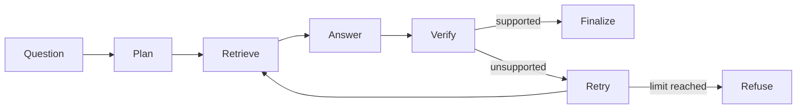

<picture>
  <source media="(max-width: 600px) and (prefers-color-scheme: dark)" srcset="assets/chaiops-hero-mobile-dark.svg">
  <source media="(max-width: 600px) and (prefers-color-scheme: light)" srcset="assets/chaiops-hero-mobile-light.svg">
  <source media="(prefers-color-scheme: dark)" srcset="assets/chaiops-hero-dark.svg">
  <source media="(prefers-color-scheme: light)" srcset="assets/chaiops-hero-light.svg">
  
</picture>

<p align="center">
  <strong>Backend systems for when the happy path leaves the building.</strong>
  <br>
  <a href="mailto:dbhat.cs@gmail.com">email</a> ·
  <a href="https://www.linkedin.com/in/devashish-bhat/">linkedin</a> ·
  <a href="assets/resume.pdf">résumé</a>
</p>

### `CURRENT_PROCESS`

Building an LLM recommendation service on AWS Lambda and hybrid marketplace search. Measuring first; hand-waving later.

## `INCIDENT_ARCHIVE`

<a href="https://github.com/devashishbhat/ledger-agent">
  <picture>
    <source media="(max-width: 600px)" srcset="assets/project-ledger-mobile.svg">
    
  </picture>
</a>

<a href="https://github.com/devashishbhat/Jirassic">
  <picture>
    <source media="(max-width: 600px)" srcset="assets/project-jirassic-mobile.svg">
    
  </picture>
</a>

<a href="https://github.com/devashishbhat/Wmaps">
  <picture>
    <source media="(max-width: 600px)" srcset="assets/project-wmaps-mobile.svg">
    
  </picture>
</a>

<details>
<summary><strong>OPEN RUNBOOK // loadout + field logs</strong></summary>
<br>

<p align="center">
  
</p>

```text
PAYMENT RAIL     name verification under 300 ms p95
FAILURE PATH     restart-safe batches; no duplicate debits after recovery
PARALLEL LAB     150+ students mentored across OpenMP, MPI, and CUDA
COMMUNITY MODE   1,000+ members; 14 events; one seven-person crew
```

</details>

<details>
<summary><strong>TRACE LEDGER // how an answer earns its citations</strong></summary>
<br>



The model handles language. Code checks every quote. If the evidence does not survive verification, the system refuses.

</details>

---

<p align="center">
  <strong>If your backend has an interesting failure mode, bring it.</strong>
  <br>
  I’ll bring the chai. <a href="mailto:dbhat.cs@gmail.com">Start a trace →</a>
</p>
