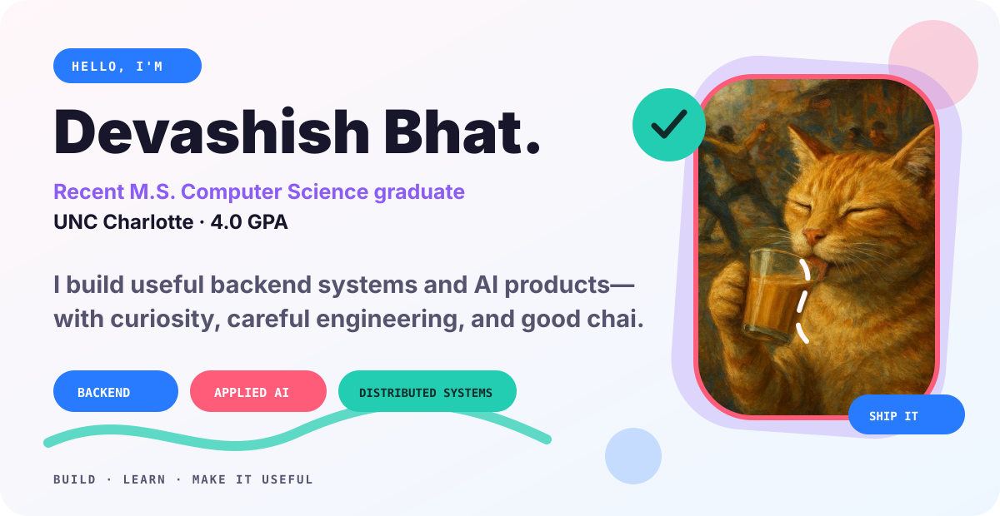
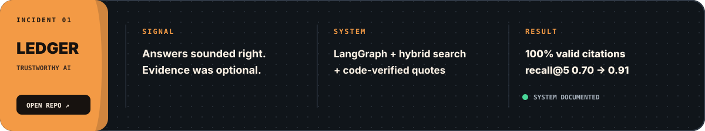
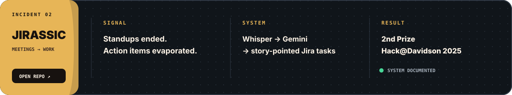
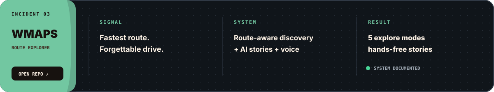

<picture>
  <source media="(max-width: 600px) and (prefers-color-scheme: dark)" srcset="assets/portfolio-hero-mobile-dark.svg">
  <source media="(max-width: 600px) and (prefers-color-scheme: light)" srcset="assets/portfolio-hero-mobile-light.svg">
  <source media="(prefers-color-scheme: dark)" srcset="assets/portfolio-hero-dark.svg">
  <source media="(prefers-color-scheme: light)" srcset="assets/portfolio-hero-light.svg">
  
</picture>

  <a href="mailto:dbhat.cs@gmail.com"><strong>Email</strong></a>
  &nbsp;·&nbsp;
  <a href="https://www.linkedin.com/in/devashish-bhat/"><strong>LinkedIn</strong></a>

## A little about me

I'm a recent **M.S. Computer Science graduate from UNC Charlotte with a 4.0 GPA**. I enjoy turning complicated ideas into useful software, especially backend systems, distributed applications, and AI products that are thoughtful about how they behave in the real world.

Right now, I'm working on an LLM recommendation service and hybrid marketplace search. I like projects where there is something interesting to learn, something real to build, and a clear reason for the software to exist.

## Selected work

<a href="https://github.com/devashishbhat/ledger-agent">
  <picture>
    <source media="(max-width: 600px)" srcset="assets/project-ledger-mobile.svg">
    
  </picture>
</a>

 

<a href="https://github.com/devashishbhat/Jirassic">
  <picture>
    <source media="(max-width: 600px)" srcset="assets/project-jirassic-mobile.svg">
    
  </picture>
</a>

 

<a href="https://github.com/devashishbhat/Wmaps">
  <picture>
    <source media="(max-width: 600px)" srcset="assets/project-wmaps-mobile.svg">
    
  </picture>
</a>

## What I work with

  

  <strong>Backend engineering</strong> &nbsp;·&nbsp;
  <strong>Applied AI</strong> &nbsp;·&nbsp;
  <strong>Data systems</strong> &nbsp;·&nbsp;
  <strong>Cloud infrastructure</strong>

## Beyond the code

I have taught parallel and distributed computing, helped students untangle tricky C++ bugs, and led a student community that made a new campus feel a little more like home. I care about good systems, but I care just as much about the people using and building them.

---

### Let's build something interesting.

Have an idea, a difficult engineering problem, or a strong chai recommendation?

[**Say hello**](mailto:dbhat.cs@gmail.com) &nbsp;·&nbsp; [**Connect on LinkedIn**](https://www.linkedin.com/in/devashish-bhat/)

